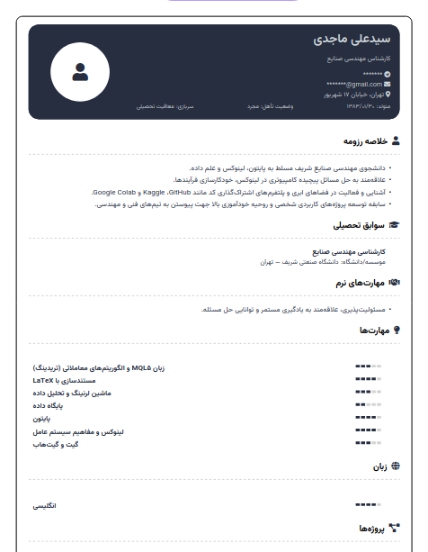
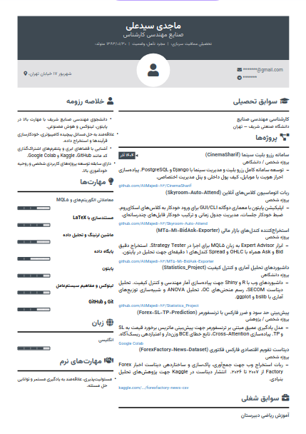

# Persian Resume Template

  
  

This repository contains professional Persian LaTeX resume templates designed for clean and modern curriculum vitae typesetting.

### Usage
You can compile these templates using the **XeLaTeX** compiler locally or on [Overleaf](https://www.overleaf.com/).

### Credits
- Based on the "Awesome_CV" template originally created by <a href="https://github.com/posquit0">posquit0</a>: [GitHub Repository](https://github.com/posquit0/Awesome-CV)

---

<h1 dir="rtl">قالب رزومه فارسی (LaTeX)</h1>

این مخزن شامل قالب‌های حرفه‌ای و مدرن رزومه فارسی با استفاده از زبان لیتک (LaTeX) است.

<h3 dir="rtl">نحوه استفاده</h3>

شما می‌توانید این قالب‌ها را به صورت محلی یا در پلتفرم <a href="https://www.overleaf.com/">Overleaf</a> با کامپایلر <strong>XeLaTeX</strong> اجرا و ویرایش کنید.

